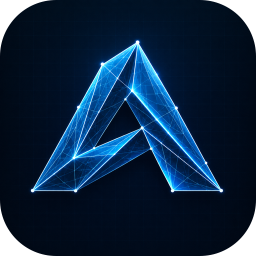
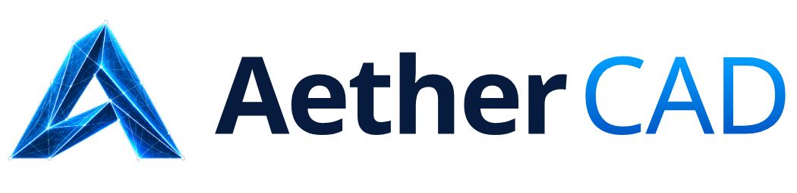
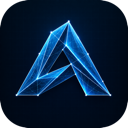
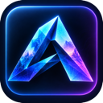
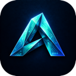
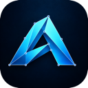

<!-- Product section generated by AetherStudio/dev/site/build_pages.py (apps.py). Edit there; developer notes below the line are kept. -->

> **Alpha 0.1:** [release setup, shared UI and current limitations](ALPHA_0_1.md). Fetch the checksum-locked vendor packages before installing dependencies.

<p align="center"></p>

<h1 align="center">
  <picture>
    <source media="(prefers-color-scheme: dark)" srcset="assets/branding/aether-cad-wordmark-dark.png">
    
  </picture>
</h1>

<p align="center">3D parametric parts, assemblies and production drawings.</p>

<p align="center">
  
  
  <a href="https://jenkinsrobotics.github.io/Aether-CAD/"></a>
</p>

Sketch a profile, add features and edit any step of the history. Aether CAD runs a native FreeCAD/OpenCASCADE kernel behind its own feature model, so every part rebuilds exactly — and every action is available to you, your team and your AI. An open alternative to SolidWorks, Onshape and Shapr3D.

> **Alpha 0.1 — early access.** Aether CAD is alpha software: features are incomplete,
> file formats may change between alphas, and it is not yet qualified for production
> work. Every feature below is marked as working today, in progress or planned.

## Features

### Works today

- ✅ **Constrained sketching** — Lines, arcs, circles, ellipses, conics and fit splines with free end tangents. Dimensions, geometric constraints, whole-entity Fix and connected-region selection.
- ✅ **Extrude, fully featured** — Blind, symmetric, through-all, up to next / face / part / vertex, signed end offsets, draft, thin walls, independent ends and multi-region profiles with holes.
- ✅ **Revolve, Sweep, Loft, Shell** — Directional and symmetric revolve extents, native sweep and loft, shell, Hole, Draft, fillet and chamfer, patterns, Booleans, mirror and part transform/copy.
- ✅ **Editable history** — Roll back, suppress, reorder and edit any feature; live native previews with Cancel/Apply; undo/redo; strict rebuild errors you can recover from.
- ✅ **Exact import and export** — Import STEP, IGES and BREP solids and STL/OBJ/PLY/OFF meshes (with closed-mesh-to-solid conversion). Export exact STEP and STL.
- ✅ **Inspect and analyse** — Measurements, angular inspection, capped section views and native volume interference between bodies.

### In progress

- 🔨 **Assemblies** — Mates against the native solver — fastened, revolute and prismatic today; the full joint set, limits, nested assemblies and BOM are next.
- 🔨 **References that survive edits** — Stable face and edge identity through upstream dimension changes, splits and merges.
- 🔨 **Fluid previews on big parts** — Revision-aware incremental evaluation, measured against cold rebuilds.
- 🔨 **Variables and configurations** — Expressions, units and configuration tables driving parts and assemblies.

### Planned

- 🗺️ **Production drawings** — Associative views, dimensions, tolerances, sections, title blocks and PDF/DXF output that update with the model.
- 🗺️ **Sheet metal and frames** — Flanges, bends, flat patterns, frame profiles and cut lists.
- 🗺️ **Surface modelling** — Surface authoring, continuity, trim, stitch and thicken.
- 🗺️ **Release and manufacturing** — Released BOMs and drawings, rendering, simulation and CAM integrations.

## Built-in AI · Works today

Connect ChatGPT, Claude or Gemini once in Aether Studio (**Plugins → My connections**).
Agents use the app's own commands — validated, undoable and recorded. AI is optional:
nothing you save ever needs it.

- Inspect a part's features and exact faces, then create rectangle, circle and polygon sketches and extrude or revolve them.
- Preview and change extrusion depth, Up-to-next end offsets and revolve extents; suppress, restore and reorder features.
- Every edit rebuilds through the native kernel and lands in the normal history and save flow — undo works exactly as if you had clicked it.
- The same tools are available from the command line and as MCP tools, with scoped permissions and safe retries.

Example: “Create a 40 × 20 mm rectangle on the XY plane and extrude it 5 mm.”

## On its own, or with Aether Studio

Aether CAD keeps its core features on a single machine. Connect it to
[Aether Studio](https://jenkinsrobotics.github.io/AetherStudio/), your own server, and it gains what a
team needs: access from any device, built-in AI, PDM with versions, branches and
releases, and multi-user sharing, comments and tasks. Parts and assemblies live in Drive with versions, branches and releases; teammates review the same model, comment on it and pick up tasks.

## What every Aether app brings

- **Runs on its own.** Open an app on one machine and work locally. Your files stay on your disk in open, documented formats. _(local install today · downloadable desktop app planned)_
- **Or on your own server.** Point the apps at an Aether Studio server — a Mac Studio in the office or a rack of machines — and the whole team works from one place.
- **Any device.** Every app is a web app first, so laptops, desktops and tablets connect through a browser — no install on the client. _(desktop downloads planned)_
- **Built-in AI.** Connect ChatGPT, Claude or Gemini once in Studio. Each app's AI advisor edits your open document with the app's own tools — and AI is never required to open or play your work.
- **PDM and version control.** Versions, branches, releases and obsolescence for every document, with a visual version graph and restore.
- **Multi-user.** One account across every app, shared workspaces, permissions, comments and tasks. _(real-time co-editing in progress)_
- **Command line and MCP.** Every agent tool is also a CLI command and an MCP tool, with scoped grants, revision guards and retry receipts.
- **Open source.** Apache-2.0. Own your tools, your files and your server.

## Roadmap

| Release | Focus | What it means |
|---|---|---|
| Alpha 0.1 | Part modelling | Sketching, the core solid features, editable history, exact STEP exchange and agent tools. |
| Alpha 0.2 | Assemblies | The full mate set, robust references and configurations. |
| Beta | Drawings and release | Associative production drawings, BOMs and release workflows; desktop download. |

## Get started

```sh
git clone --branch v0.1.0-alpha.1 --single-branch https://github.com/JenkinsRobotics/Aether-CAD.git
cd Aether-CAD
python3 tools/fetch-vendor.py
```

See [Alpha 0.1 setup and current limits](ALPHA_0_1.md) for frontend build and
server requirements. The web download is a frontend bundle, not a desktop installer.

See the [website](https://jenkinsrobotics.github.io/Aether-CAD/) for the full tour.

## The Aether apps

| | App | What it's for | Links |
|---|---|---|---|
|  | **Aether CAD** | **3D parametric parts, assemblies and production drawings.** · you are here | [Site](https://jenkinsrobotics.github.io/Aether-CAD/) · [GitHub](https://github.com/JenkinsRobotics/Aether-CAD) |
|  | Aether Animation | Animate characters and animatronics, then play the motion on real servos. | [Site](https://jenkinsrobotics.github.io/Aether-Animation/) · [GitHub](https://github.com/JenkinsRobotics/Aether-Animation) |
|  | Aether Map | Projection mapping and unattended show playback on Raspberry Pi players. | [Site](https://jenkinsrobotics.github.io/Aether-Map/) · [GitHub](https://github.com/JenkinsRobotics/Aether-Map) |
|  | Aether Sketch | Drawing and sketching — clean vector paths today, expressive brushes next. | [Site](https://jenkinsrobotics.github.io/Aether-Sketch/) · [GitHub](https://github.com/JenkinsRobotics/Aether-Sketch) |
|  | Aether IO | Electronics and wiring for motion hardware. | [Site](https://jenkinsrobotics.github.io/Aether-IO/) · [GitHub](https://github.com/JenkinsRobotics/Aether-IO) |
|  | Aether Vector | Vector illustration and graphic design. | [Site](https://jenkinsrobotics.github.io/Aether-Vector/) · [GitHub](https://github.com/JenkinsRobotics/Aether-Vector) |
|  | Aether Studio | Your team's server: accounts, shared files, versions and live collaboration. | [Site](https://jenkinsrobotics.github.io/AetherStudio/) · [GitHub](https://github.com/JenkinsRobotics/AetherStudio) |

---

## Developer notes

## GitHub checkout handoff — 2026-10-10

Active development is now in `Aether-CAD`. The existing app snapshot was
imported from `Temp Aether` into this GitHub-linked checkout. Source history and
original starter files are preserved there; this checkout keeps its GitHub
history and origin. No upload or running-installation cutover was performed.
Studio (server, Drive and shared packages) lives in `../AetherStudio`.
Earlier migration notes below describe historical folder names.

## Local repository handoff — 2026-10-09

This is the new local development home. The folder split, package boundaries,
setup/build integration and local Git history are complete. The original monorepo
remains the running deployment and historical backup. The GitHub origin is configured; see SOURCE_HISTORY.json.
See [development setup](../AetherStudio/LOCAL_DEVELOPMENT.md) and
[verification](../AetherStudio/migration/LOCAL_STRUCTURE_COMPLETE.md).
The earlier extraction notes below describe the initial snapshot.

# aether-cad

Local migration candidate for Aether. Extracted from the current working source,
including uncommitted changes. **Production still uses the original Aether Studio
checkout.** Read `MIGRATION.md` before switching development to this folder.

## Build

Use Node 22.12+ and npm. From `.`:

```sh
npm ci
npm run build
```

Shared Aether packages are versioned archives under `vendor/`, with lockfile
integrity checks. No frontend imports source from the original checkout. Archives
are temporary local distribution until the package registry is configured.
The platform serves these builds using `aether-platform/projects.json`.

The existing product README is retained as `README.pre-split.md` where present.
Some older paths in historical documentation refer to the former monorepo.

The FreeCAD adapter remains the default engine (`freecad-engine/`); the parked
TypeScript/WASM engine stays product-owned in `aether-engine/`. Before running
engine tests, run `npm ci` inside `aether-engine/`. Native tests additionally need
FreeCAD and `AETHER_PYTHON` set to a Python 3.11 interpreter.

## Installed service release check

`aether-cad-service` 0.2.0a5 includes the product-owned `aether_freecad`
adapter, subprocess worker and FreeCAD attribution. It no longer adds a
source-checkout directory to Python's import path. FreeCAD itself remains an
external, replaceable installation; set `AETHER_FREECAD_CMD` when it is not
found automatically. The existing Animation workspace-protocol dependency is
still explicit and is not removed by this packaging fix.

Run from this repository using the platform development environment:

```sh
AETHER_TEST_FREECAD=1 ../AetherStudio/.venv/bin/python -m pytest service/tests -q
../AetherStudio/.venv/bin/python -m pytest freecad-engine/tests --require-freecad -q
```

The service release test builds and extracts a wheel, imports it in an isolated
Python process outside the checkout, then tests native rebuild, invalid-input
recovery and STEP export/reimport. The environment flag enables the native wheel
check; without it, that test explicitly skips. A release verification must use
both commands above. This is service packaging, not a desktop installer or full
CAD feature-parity certification.

## Platform compatibility and first-release checks

The service ships `compatibility.json` alongside its Python modules. Platform API
identity is validated before service construction. The manifest also pins the
frontend/service versions and exact shared UI/session/sketch/artwork archives.
Change these pins intentionally when updating dependencies; archives are immutable.
This service requires Aether Platform 0.2.0a4 or newer.

From the sibling platform checkout, run
`.venv/bin/python suite.py release --workers 2` for the combined Map/CAD framework
acceptance. This includes production builds, shared UI, permissions/history/agent
regressions, installed-wheel checks, Map playback, and required native CAD document
workflows and engine tests. It writes detailed evidence to `.verification/release/`.
Physical device qualification and offline desktop installation remain separate.


## Saved CAD commands and extrusion end offsets

Studio agent connections can inspect saved CAD features and exact native faces,
preview/change extrusion depth or Up-to-next end offset, suppress/restore and
reorder features. Changes use the editor's document/history/translation helpers,
then native rebuild validation and platform revision/history checks. Attached
sketch frames and generated body identities are resolved before saving.
See [agent access](service/aether_cad_service/AGENT_ACCESS.md) for permissions,
installation and limits. Build the frontend/automation bundle before a wheel.
These commands do not access unsaved editor selections or return pixel previews.

Extrude → Up to next now has a signed End offset: positive stops short, negative
extends beyond the stopping face. It persists through reopen and recomputes when
upstream geometry moves. This native mode currently requires a fully covering,
parallel planar stopping face; arbitrary curved limits remain unsupported.


Revolve now supports reversed, symmetric and independent opposite angular
extents through the native Revolution/Groove path. Angles total at most 360°;
symmetric and independent opposite angles are mutually exclusive. The editor
converts displayed angle units to persisted degrees. Agents use explicit degrees
and strict boolean flags through `cad.revolve.preview` and
`cad.revolve.setextent`. Arbitrary axes, referenced angular limits, thin/surface
revolve and Revolve Intersect remain separate unfinished capabilities.

## CAD file import

Use the document-name menu → **Import CAD…**, the Home import command, or drop
files onto the viewport. Choose the files, set the source units for meshes, then
choose **Mesh reference** or **Convert closed mesh to solid** and Import. A batch
is added to the current Part only after native evaluation succeeds. Cancel,
invalid files and intervening document changes leave the Part unchanged.
Double-click its Import feature to change units or convert a reference later.
Save as `.acpart` to retain the original source and repeatable feature history.

Supported here: STEP/STP, IGES/IGS and BREP/BRP solid geometry; STL (binary/ASCII),
OBJ, PLY and OFF meshes. STEP/IGES retain file units; BREP uses millimeters.
Mesh source units must be selected explicitly. References support display, body
selection, appearance and STL export. Solid editing and STEP export require a
valid closed-mesh conversion; curved STL surfaces remain faceted. Importing
SolidWorks `.sldprt`/`.sldasm` requires exporting STEP from SolidWorks first.
SVG/DXF enter through Sketch import. File import does not recover source feature
trees, assembly mates or texture/material assets.

Current limits: 3 MiB per source, 4 MiB per saved Part, 32 files per batch,
100,000 mesh-reference triangles and 10,000 triangles for solid conversion.
Raw interchange files in Drive must be added through Import CAD in a Part;
direct document-tab opening is rejected so a source file cannot be overwritten
with Part JSON. These source changes require an explicit release promotion to
reach the installed application.
