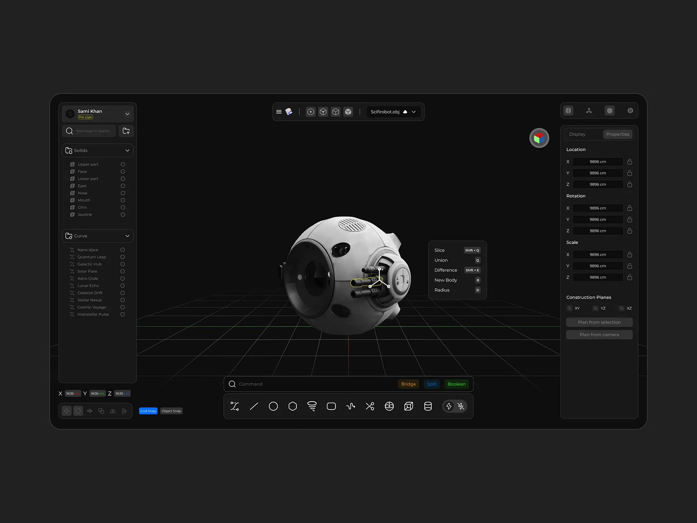

# Spacecraft modeling through MCP — future agent test prompt

**Status:** Prepared at Jonathan's request on 2026-10-16. **Not run.** This file
does not schedule a test or authorize running it now. Use it when Jonathan asks
to execute the benchmark.

**Purpose:** Find out how well a real agent can build the referenced spacecraft
using Aether CAD's existing MCP pipeline, and turn observed limitations into a
prioritized improvement list.

**Reference:** [Spacecraft image](references/spacecraft-reference.png), supplied
by Jonathan. This is the spherical robot/spacecraft shown in the Plasticity-style
interface, not the Train Cart Wheel or the rectangular Spotlight Studio object.
The image is kept here so the prompt does not depend on a temporary clipboard
path. Give the image to the agent as a visual input when running the test.

## Prompt to give the modeling agent

You are evaluating Aether CAD's current agent modeling workflow. Build a faithful,
editable CAD interpretation of the spacecraft in the supplied reference using
the application's MCP pipeline. The goal is both a useful model and an honest
record of what the agent interface needs next. Do not assume that functionality
demonstrated in Model Studio's procedural mesh demo is available in CAD or MCP.

### 1. Establish the actual test environment

- Record the date, agent/model/provider, client, CAD build and host/worker versions
  where discoverable. Distinguish an actual reasoning agent run from a scripted
  sequence of predetermined tool calls. A scripted fixture is transport evidence,
  not evidence that an agent independently modeled the reference.
- Use a new, dedicated test document/project named `MCP Spacecraft Benchmark`
  with a unique run suffix. Do not modify an existing user model. If the current
  tools cannot create the blank document, ask for that setup and record the
  manual step; do not count it as agent document creation.
- Discover the connected MCP tools and their schemas. Read the CAD operation
  catalog before choosing a feature strategy. Tool names and capabilities must
  come from discovery, not from assumptions in this prompt or older documentation.
- Prefer external MCP access to a shared live CAD editor, so edits, feature
  history, undo and viewport feedback can be observed together. The documented
  live-editor command family includes `editor.list`, `editor.inspect`,
  `editor.invoke` and `editor.result`; discover their current MCP spellings and
  argument schemas. Use only the explicitly shared benchmark document.
- If only saved-document MCP access is available, report that limitation and
  identify the run as a saved-document test. Keep its results distinct from live
  editor results. If MCP, access grants or the engine are unavailable, return a
  setup-blocked report rather than replacing this with another modeling route.
- Record manual setup, manual modeling and manual evidence capture separately.
  Do not silently treat a person's intervention as an agent capability.

### 2. Keep construction inside the product pipeline

All model-changing operations must go through discovered MCP tools that invoke
Aether CAD's validated modeling commands. Use ordinary editable features,
sketches, bodies and, where supported, reusable Parts and Assembly instances.

Do not generate the object in Three.js, Blender, raw FreeCAD scripts, direct
kernel calls or a custom mesh generator. Do not write Part JSON, patch document
archives, write the database, inject browser code, or import a prebuilt model to
bypass missing operations. Encoding a supported bounded CAD program as the MCP
tool's documented input is allowed; arbitrary executable code is not.

Do not add tools, modify implementation or upgrade the installation during the
baseline run. Record missing capabilities first. Any implementation and rerun
should be a separate, explicitly requested task so the baseline stays meaningful.

### 3. Analyze the reference and plan editable features

The principal visible forms to reproduce are:

1. A pale, rounded main shell with a recognizable spherical spacecraft silhouette.
2. A large dark, recessed circular front aperture/lens with a layered rim.
3. A circular side pod with stepped concentric covers and a central face detail.
4. Several short cylindrical side appendages, including their sockets and ends.
5. A top vent/grille and smaller recessed sensor openings or dark inset panels.
6. Panel seams, repeated fasteners and other secondary details visible in the image.

Prioritize silhouette and major proportions, then recesses and layered forms,
then repeated detail and appearance. Treat yellow outlines and white handles as
selection UI, not physical spacecraft geometry. Do not model the surrounding
toolbars, panels, floor grid or application window.

The reference has no reliable physical scale and shows only one viewpoint. Use
**120 mm as the main shell's approximate outside diameter**, unless the operator
supplies a different scale. This is a benchmark assumption, not a measurement
from the image. Declare the coordinate convention, front direction and estimated
relative proportions. Keep unseen rear/underside construction simple and label
it as inferred; do not invent unsupported reference detail.

Propose a short feature plan using discovered operations. Prefer meaningful
sketch/extrude/revolve/add/cut and repeated-instance workflows where supported.
Use primitives when they are a reasonable design choice, not as a way to claim
an unsupported detailed feature was completed. Name major features and bodies so
a person can understand and edit the result afterward.

### 4. Build incrementally and inspect the results

Work in small, undoable checkpoints:

1. Main shell, overall proportions and front aperture.
2. Side pod, rings and appendages.
3. Vents, sensors, seams and repeated details.
4. Materials/colors and final visual presentation, if exposed by MCP.

After each checkpoint, inspect the feature history and exact geometry, and request
viewport evidence through MCP where available. Confirm the intended bodies and
cuts actually exist; a successful tool receipt alone is insufficient. Inspect
native rebuild errors and failed/suppressed features before proceeding.

Respect discovered program limits, explicit units, target identities and revision
guards. Re-query topology after changes instead of reusing stale face identifiers.
For an uncertain asynchronous result, inspect its operation receipt/current state
before retrying; reuse the operation ID when the protocol requires it. Do not
create duplicate geometry by guessing that a timed-out operation failed.

When blocked, record the attempted operation and actual response, then try a
supported alternative only if it still serves the model. Label substitutions
as approximations. For example, repeated simple cuts may approximate a grille;
a dark disk does not demonstrate a recessed cut, fillet or shell operation.
Avoid repeating an identical failure without new information. Continue independent
features when possible and preserve the partial model if a core capability is absent.

### 5. Verify modeling and persistence, not just appearance

- Verify dimensions against the declared scale and feature parameters. Report
  units, body counts, bounds and exact volumes for major solids where the tools
  support them. Require finite, valid results and explain intentional separate
  bodies or overlaps. Do not substitute a triangle count or screenshot for exact
  CAD geometry evidence.
- Check the front recess, side-pod layers, appendage attachment and vent/sensor
  depth through topology, measurements and alternate views where available.
- Change one meaningful upstream parameter, such as a side-pod radius or
  appendage length. Verify that the affected geometry updates through ordinary
  feature regeneration and report any broken references. Restore the intended
  final value before the final save.
- Exercise an ordinary undo and redo around one modeling change. Confirm both
  geometry and history reflect the expected states. A missing undo endpoint is
  a recorded gap, not a passing test.
- Save through the application's normal supported workflow. Reopen or reload the
  benchmark document, then re-inspect its features and geometry. Demonstrate that
  the final model is editable CAD content, not a viewport-only scene.
- Capture a reference-matched three-quarter view and, if supported, front, side,
  rear/underside and close-up views. Record missing camera, selection, section
  or image-return controls. If a person captures a view manually, label it as
  UI-assisted evidence; it does not prove MCP camera/rendering coverage.
- If export is available, optionally verify a neutral CAD export without replacing
  the native editable document. Missing export is a gap, not a reason to fabricate
  or generate the artifact outside the application.

### 6. Deliver the model and an evidence-based gap report

Keep the native benchmark document and identify its final saved revision. Store
run notes, screenshots and sanitized tool transcripts together in a run directory
such as `docs/ai-agent/runs/<date>-spacecraft-<run-id>/`, or another operator-approved
evidence location. Never include account secrets or access tokens in transcripts.

The report must include:

1. **Run summary:** actual pipeline used, agent/provider, versions, elapsed time,
   model/document identity, final revision, and all human assistance. State
   whether the model is complete, partial or setup-blocked.
2. **Feature ledger:** one row per planned visual feature, with its modeling
   operations, resulting feature/body IDs, status (`achieved`, `approximated`,
   `blocked` or `not attempted`), evidence and limitations.
3. **Verification ledger:** exact geometry, parameter edit/regeneration, undo/redo,
   save/reopen and viewport feedback, each marked `pass`, `fail` or `not tested`.
   Do not conflate a saved-file test with live-editor or real-provider coverage.
4. **Visual review:** score each of the six reference feature groups from 0–3:
   0 absent, 1 rough stand-in, 2 recognizable with differences, 3 close to the
   visible reference. Include comparative images and explain the differences.
   Mark judgments as agent self-assessment until a human reviews them. A strong
   visual score does not override failed editability or persistence checks.
5. **Failure log:** tool/operation name, sanitized inputs, response/error,
   relevant revision or receipt, expected behavior, observed behavior and recovery.
6. **Prioritized improvements:** distinguish absent CAD functionality, existing
   functionality not exposed through MCP, discovery/documentation problems,
   selection/topology issues, camera/visual feedback gaps, persistence/retry
   problems, performance limits and agent planning mistakes. For each, include
   user impact, evidence, any workaround, the likely owning layer and a concrete
   acceptance test. Label an unverified suspected cause as a hypothesis.

For the improvement table, use:

| Gap | Observed evidence | Impact / workaround | Owning layer | Priority | Acceptance test for a future rerun |
| --- | --- | --- | --- | --- | --- |

The benchmark is useful even if the spacecraft cannot be completed. Do not claim
full modeling success while required features are missing, approximated without
disclosure, or unverified after reopen. Finish with the three improvements that
would most improve the next agent attempt, and retain the partial model and
evidence so the next run can be compared against this one.

## Documentation context for the future operator

- [CAD agent access](../../service/aether_cad_service/AGENT_ACCESS.md): product
  operations, adapters and constraints. Historical command counts are not a
  substitute for discovery against the installation under test.
- [Studio agent/MCP coverage](../../../AetherStudio/dev/rebuild/AGENT_COVERAGE.md):
  recorded transport and live-editor qualifications, including the plate/bore
  fixture. That fixture is not a result for this spacecraft benchmark.

No spacecraft benchmark result exists in this document. Add a separately dated
run report only after execution.
